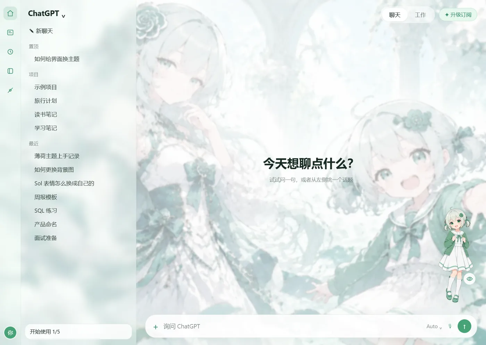
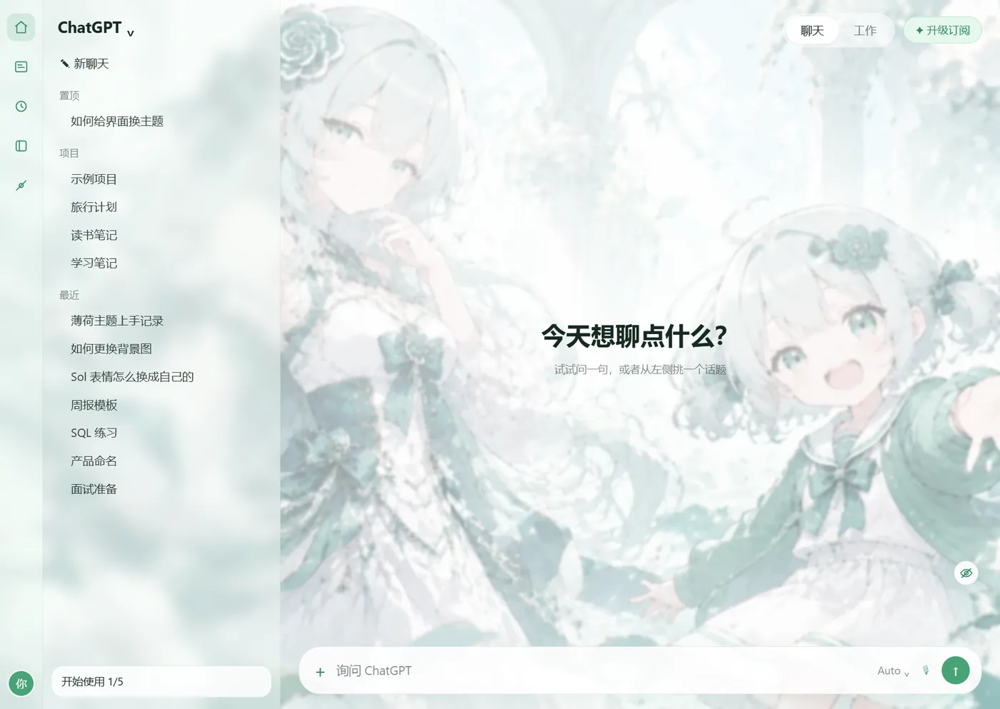

# ChatGPT Mint Skin

一套给 **ChatGPT 官方桌面版**（Windows，Microsoft Store 版）做的**界面美化主题**：薄荷色系、半透明磨砂面板、背景插画、侧栏 Q 版小人，以及一个会跟着对话状态换表情的助手 **Sol**。

皮肤不改程序本体，只在你启动的那一次给运行中的窗口"贴一层膜"：注入一套配色与装饰层，**双击图标即用，关掉即还原**。



| 助手 Sol | 一键隐藏 |
| --- | --- |
|  |  |

> 截图中的会话标题、项目名与头像均为演示数据，不是真实聊天记录。


---

## 特性

- **白 / 淡绿主题**：覆盖 ChatGPT 自己的设计令牌（主面板、侧栏、边框、文字、强调色），主面板半透明、侧栏磨砂，壁纸透出来但正文仍然清楚。
- **背景插画**：内置 18 张壁纸；右下角"图片"按钮打开**背景面板**，缩略图 + 中文名点选即换，支持**循环播放**（30 秒 / 1 / 5 / 15 分钟）；配置里也可用 `fixed` / `random` / `rotate`。
- **Sol 助手**：整身立绘常驻右下，头顶表情气泡随对话状态切换——空闲 / 倾听 / 思考（托腮）/ 完成（举手）/ 出错；右下角"眼睛"按钮可一键隐藏，偏好会记住。
- **侧栏 Q 版**：可替换的表情小人。
- **零侵入启动**：Node 启动器负责带调试端口启动、还原被收进托盘的窗口、拉起守护进程；桌面与开始菜单各一个快捷方式，目标是最普通的 `node.exe`。
- **可自检**：`doctor`（入口/图标/进程/端口/守护进程/皮肤/背景库/安全软件）+ `verify`（50+ 项注入验收）+ 调试小工具。

## 环境要求

- Windows 10 / 11；
- **Microsoft Store 版 ChatGPT**（包 `OpenAI.Codex`，开始菜单里那个）；
- **Node.js 20+**（`node -v` 能看到版本即可，不需要 `npm install`，零依赖）。

**macOS**：本次尝试以新版 ChatGPT 桌面客户端为目标。现有启动器依赖 Windows Store 的启动别名和 PowerShell，皮肤还需要连接 ChatGPT 主窗口的本机调试接口。当前没有可实测的 Mac，主窗口连接、应用皮肤和还原流程均待验证。v1.3.3 提供 Windows 安装包。

## 一键安装

1. 解压到一个**自己留着的位置**（别放临时目录，删了皮肤就没了），例如 `D:\apps\chatgpt-mint-skin`；
2. 双击 **`setup.cmd`**：检查 Node 与 ChatGPT → 建桌面 + 开始菜单快捷方式（Sol 图标）→ 问你要不要开机自启；
3. 以后就双击桌面上的 **ChatGPT** 图标。

要单独把现有的美化版桌面和开始菜单快捷方式改为 Sol 图标，可从开始菜单打开 **换成 Sol 图标**，或在解压目录双击 `set-sol-icon.cmd`。

从 GitHub Release 下载时，可在 PowerShell 运行 `Get-FileHash .\chatgpt-mint-skin-v1.3.3.zip -Algorithm SHA256`，把结果与同一 Release 中的 `SHA256SUMS.txt` 比对。发布源码或转发安装包时请保留 `LICENSE`、`NOTICE` 和角色素材署名。

需要走代理才能访问 chatgpt.com 的话：

```bat
setup.cmd -Proxy http://127.0.0.1:7890
```

> 装完想调整：`node tools\doctor.mjs --repair` 重建快捷方式，`node tools\doctor.mjs` 体检，`node tools\verify.mjs` 验收皮肤。

## 双击之后会发生什么

`launch-skin.mjs` 会保留已经打开的窗口和会话：

| 应用状态 | 行为 |
| --- | --- |
| 完全没开 | 用执行别名带调试端口启动 → 等端口就绪 → 起守护进程 |
| 已开着且窗口可见 | 直接聚焦窗口，确保守护进程在跑 |
| 被最小化 | 调 `show-window.ps1` 还原 |
| 点了 ✕ 收进托盘 | 尝试恢复原窗口。恢复不了时，请从系统托盘打开 |
| 开着但没调试端口 | 保留原窗口并给出提示。保存草稿、等生成结束后，可自行从托盘退出，再打开美化版 |

从旧版升级时，先运行旧版目录里的 `tools\skin-stop.ps1` 停掉旧守护进程，再在新版目录运行 `setup.cmd` 更新快捷方式。想恢复原版界面时，双击新版目录里的 `restore-stock.cmd`，当前窗口可以继续使用。

## 配置

全部在 `config/skin.json`（保存即热重载；改 `src/*.mjs` 需要重启守护进程）：

```jsonc
{
  "palette": {
    "surface": "rgba(240, 252, 246, 0.42)",  // 聊天主面板，alpha 越小越透
    "sidebar": "rgba(244, 252, 248, 0.48)",
    "ink": "#172a21",
    "accent": "#47a377",
    "radius": "18px"
  },
  "background": {
    "mode": "fixed",                          // fixed | random
    "asset": "assets/background-garden.webp",
    "list": [],
    "position": "center 18%"
  },
  "characters": [],                            // 想叠独立立绘就加条目（见下）
  "chibi": { "asset": "assets/chibi/chibi-happy.webp", "width": "52px" },
  "assistant": {
    "enabled": true,
    "mode": "bubble",                          // bubble（立绘+气泡）| pose（只放表情）
    "size": "30vh",
    "visible": true,
    "controls": true,
    "doneMs": 2500,
    "smileMs": 5000
  }
}
```

完整字段见 [`config/skin.schema.json`](config/skin.schema.json)。

## 和 Sol 互动

点 Sol 脚边的「•••」可打招呼、摸摸头或给自己打气。Sol 会回应不同的台词和表情，并切换姿势。点侧栏的 Astra 会轮换触发三组双人互动，可在外观面板关闭「Astra 联动」。专注阅读期间，Sol 保留主动互动并暂停待机动作。

Sol 不只是站着：她在右下角是可以点、可以拖的，全部**本地完成**——不联网、不读聊天内容。

| 你怎么做 | 她的反应 |
| --- | --- |
| 点一下 | 说一句随机台词（`lines.click`），气泡表情跟着变 |
| 连点 / 抚摸 | `pets` 计数 +1，攒到 10 / 30 / 50 … 会撒爱心并说特别的话（`lines.pet`） |
| 按住拖动 | 立绘跟着走，松手后**位置被记住**；下次打开还在那里 |
| 双击 | 位置复位到右下角 |
| 鼠标悬停 | 轻轻上浮一下 |
| 每次打开应用第一次出现 | 按当前时段打招呼（早上 / 下午 / 晚上 / 深夜，`lines.greet`） |
| 放着不管 1 分钟 | 自己伸懒腰、摇摆一下（`idleMs` 可调） |
| 打开背景面板 | 自动左移 + 半透明让位，关掉面板回到原位 |

```jsonc
"assistant": {
  "interactive": { "enabled": true, "click": true, "drag": true, "hover": true, "idle": true },
  "captionMs": 2600,        // 台词停留时间
  "idleMs": 60000,          // 多久没互动开始自己玩
  "greet": true,            // 按小时问候
  "lines": {
    "greet": ["早上好，今天想聊点什么？", "…"],
    "click": ["在呢在呢", "你又戳我～"],
    "pet":   { "10": "今天也要加油哦", "30": "被你摸得有点害羞…" }
  }
}
```

- 只想要"会动但别碰我"：`interactive.enabled: false`（立绘和状态表情照常，热区消失）。
- 连眼睛按钮都不想要：`controls: false`；整个助手不显示：`enabled: false`。
- 记住的东西存在浏览器本地：`ccs-sol-pos`（位置）、`ccs-sol-pets`（抚摸次数）、`ccs-sol-greeted`（今天的问候）。
- 控制台调试：`__ccsAssistant.say('hi')`、`.react('hug')`、`.pets`、`.position`、`.resetPosition()`。


## 换成自己的素材

| 想换 | 文件 | 规格 |
| --- | --- | --- |
| 壁纸 | `assets/backgrounds/bg-*.webp`（用 `tools\import_backgrounds.py` 导入） | 16:9，主体人物靠两侧，中间偏浅 |
| Sol 立绘 | `assets/sol/body.webp` | 透明 PNG/WebP，竖图，人物贴底 |
| Sol 表情 | `assets/sol/emote-{idle,listening,thinking,done,error}.webp` | 正方形，透明背景 |
| 侧栏 Q 版 | `assets/chibi/chibi-happy.webp` | 正方形，透明背景 |
| 快捷方式图标 | `assets/app-icon.ico`（多尺寸） | 透明底 |

从零做素材的脚本也在仓库里：

```powershell
# 从 3x3 表情合集切一格并去掉白底（3x3 九宫格：1 举手 2 双拇指 3 生气 4 哭 5 害羞 6 惊吓 7 打哈欠 8 托腮 9 张手）
python tools\make_chibi.py --src assets\sol\sheet-src.png --cell 8 --size 512 --out assets\sol\emote-thinking.png

# 从"深色渐变背景"的整身立绘抠出人物
python tools\make_sol.py --src assets\sol\body-src.png --out assets\sol\body.png

# 白底图标去白底并生成多尺寸 ICO
python tools\make_app_icon.py --src assets\app-icon-src.png

# 把运行时素材压成 WebP（发布前用）
python tools\optimize_assets.py
```

## 背景库、选择面板与循环播放

仓库自带 **18 张壁纸**（`assets/backgrounds/bg-01.webp … bg-18.webp`），名称记在
`assets/backgrounds/index.json`：

| | | |
| --- | --- | --- |
| 翡翠玫瑰宫 | 霓虹双星 | 秋日童话 |
| 樱花序曲 | 薄荷花园中的双少女幻想曲 | 薄荷幻想庭院中的双星 |
| 窗畔薄荷双姝与梦幻城堡 | 樱花树下的温暖校园时光 | 雨夜霓虹下的姐妹羁绊 |
| 午后星光与花瓣的梦境 | 星环花庭与飞舞少女 | 暮色蒸汽飞艇上的星辉冒险 |
| 雪夜花灯下的姐妹与白兔 | 月下哥特玫瑰庭园 | 星空湖畔的温暖露营夜 |
| 极光下的冬夜相依 | 阳光花园里的姐妹茶会 | 山坡花影下的午后阅读 |

### 换背景：右下角"图片"按钮

聊天窗口右下角（Sol 眼睛按钮左侧）有一个小图片图标：

1. **静态背景**保留 18 张内置壁纸。「我的图片」可导入多张 JPEG、PNG 或 WebP，最多 12 张，单张最多 15 MB、3200 万像素。图片副本只保存在当前电脑。点缩略图就会设为背景，删除正在使用的图片会恢复上一次的内置静态背景。
2. **动态背景**单独显示薄荷花园、窗边细雨和月夜萤火。三张都有 Astra 和 Sol。选中后播放分层光影、雨滴或萤火和波纹。窗口位于后台、开启专注阅读或减少动态效果时显示带两位角色的静态画面，面板会标明暂停原因。
3. 「循环播放」只轮换内置静态壁纸。背景选择保存在本机。用 `Esc` 或点面板外关闭。

打开「专注阅读」后，聊天区使用接近不透明的底色，侧栏文字和强调色的对比更高，壁纸轮播会暂停。关闭后恢复原来的外观和轮播偏好。阅读模式、背景选择和轮播设置都保存在本地。
窗口最小化/隐藏时轮换暂停，回来继续。

### 配置

```jsonc
"background": {
  "mode": "rotate",            // fixed 固定 | random 每次注入随机 | rotate 定时轮换
  "rotateMs": 60000,           // rotate 的停留时间（毫秒），面板里可临时改
  "picker": true,              // 显示右下角背景按钮与面板
  "list": ["assets/backgrounds/bg-01.webp", "…"],   // 显示顺序 = 轮换顺序 = 面板顺序
  "asset": "assets/backgrounds/bg-01.webp",         // fixed / 兜底
  "opacity": 1,
  "position": "center 18%"
}
```

想加自己的图：丢进 `assets/backgrounds/`，运行 `python tools\import_backgrounds.py`
（源图放 `assets/backgrounds/_src`，命名 `NN-中文名.png`），它会转 WebP 并重建 `index.json`。
细节见 [`assets/backgrounds/README.md`](assets/backgrounds/README.md)。

> 18 张全量以 data URL 注入，首次注入载荷约 5 MB、耗时约 1 秒；若嫌重，可删减 `index.json`
> 条目或调小 `tools/import_backgrounds.py --width/--quality`。

## 常用命令

```powershell
node tools\doctor.mjs                 # 体检：快捷方式/图标/进程/端口/守护进程/皮肤/安全软件
node tools\doctor.mjs --repair        # 一键重建桌面 + 开始菜单快捷方式
node tools\doctor.mjs --autostart on  # 开机自启（off 关闭）
node tools\verify.mjs                 # 50+ 项注入验收 + 报告
node tools\verify.mjs --shot shots\verify.png
node tools\sol-toggle.mjs --hide      # 隐藏 / 显示 Sol（也会记住）
node tools\background-test.mjs        # 背景面板 / 切图 / 轮换自测 + 截图
node tools\assistant-test.mjs         # 五态表情截图
node tools\assistant-sim.mjs          # 模拟输入/提交，打印状态转移
node tools\assistant-interact.mjs     # 点击/拖动/复位/让位自测 + 截图
node tools\launch-skin.mjs            # 手动走一遍启动收敛流程
powershell -File tools\skin-stop.ps1  # 立刻卸掉皮肤（界面还原），守护进程也停
powershell -File tools\pack.ps1       # 打发布包 dist\chatgpt-mint-skin-v<ver>.zip
```

## 故障排查

| 现象 | 处理 |
| --- | --- |
| 双击快捷方式完全没反应 | 快捷方式参数只能是 `"<项目>\tools\launch-skin.mjs" --port 9335`；若被改成带 `-NoProfile` 之类 PowerShell 开关，`node` 会拒绝执行。跑 `node tools\doctor.mjs --repair` |
| 双击后窗口看不见 | 从任务栏或系统托盘找原窗口，并查看 `logs\launcher.log` |
| 快捷方式消失 | 检查安全软件是否记录了拦截，核对发布包校验值，解决原因后再运行 `node tools\doctor.mjs --repair` |
| 界面能开但一直转圈 | 网络问题：`setup.cmd -Proxy http://127.0.0.1:7890`，或先打开系统代理 |
| 内置浏览器面板发灰、点不动 | 打开右侧浏览器时，皮肤暂时让出共享渲染区域，关闭后恢复。可用 `node tools\diagnose-browser.mjs --safe on` 手动切换到原生界面进行对照，`--safe off` 解除手动模式 |
| 皮肤没出现，但 verify 通过 | 切换一次会话或 `Ctrl+R`，守护进程会自动重挂 |
| 改了 `src\*.mjs` 不生效 | 守护进程缓存了模块：先 `powershell -File tools\skin-stop.ps1`，再双击图标（改 CSS/素材/`skin.json` 不用） |
| 想确认什么都没留下 | `powershell -File tools\disable-debug.ps1 -CloseApp`，然后正常启动 ChatGPT，界面与从未装过一样 |

更多原理与选择器： [`docs/channel.md`](docs/channel.md)、[`docs/dom-map.md`](docs/dom-map.md)。

## 项目结构

```text
setup.cmd                 双击安装入口
config/skin.json          皮肤配置（唯一需要日常改的文件）
config/shortcut.json      快捷方式配置（名称/端口/代理/写到哪里）
src/cdp.mjs               零依赖 CDP 客户端
src/assets.mjs            配置合并、素材转 data URL、装饰层 DOM
src/injector.mjs          注入 / 卸载 / 状态脚本
src/daemon.mjs            守护进程：重连、重挂、热重载
src/runtime/assistant.mjs Sol 状态机（经 CDP 注入，不用 <script>）
src/styles/theme.css      设计令牌覆盖
src/styles/layers.css     壁纸 / 立绘 / Q 版 / Sol 气泡 / 显隐按钮
assets/                   壁纸、Sol 立绘与表情、侧栏 Q 版、应用图标
tools/                    启动器、体检、验收、素材与打包脚本
docs/                     原理、DOM 地图、路线图、README 截图
```

## 发布 / 上传到 GitHub

```powershell
# 打发布包（生成 dist\chatgpt-mint-skin-v<version>.zip 与 SHA256SUMS.txt）
powershell -File tools\pack.ps1
```

上传仓库（需要本机装好 Git）：

```powershell
git init
git add .
git commit -m "feat: ChatGPT mint skin v1.0.0"
git branch -M main
git remote add origin https://github.com/<you>/chatgpt-mint-skin.git
git push -u origin main
```

发布页把 `dist\chatgpt-mint-skin-v1.0.0.zip` 作为 release 附件上传即可；`.gitignore` 已排除
`dist/`、`logs/`、`shots/`、`recon/` 与原始素材 `*-src.png`。

## 已知限制

- 只在 **Windows + Store 版 ChatGPT** 上验证；应用大版本更新后页面结构可能变化，需要按 `docs/dom-map.md` 重新校准。
- 皮肤由本机调试端口注入，端口仅绑定 `127.0.0.1`，且只在使用启动器启动的那一次存在。
- Sol 的「完成」判定基于本轮新增回复的长度与生成信号。手动停止、切换会话或信号不足时回到中性状态。长度在窗口内计算，正文不会保存或外发。

## 许可与致谢

- 代码：[MIT](LICENSE)。
- **角色形象**：**Astra** 与 **Sol** 的角色设计、立绘与表情素材，来源为 **B 站 UP 主「喵了个猫了个咪了个猫」**；**已私信取得原作者同意**，允许二次创作与分享。本仓库包含的 `assets/` 图片是为适配本主题而做的二次处理（抠底、切格、压缩、转 WebP），角色版权仍归原作者，请保留署名；商业用途请先与原作者确认。
- 皮肤本身的版面（背景 + 立绘 + 侧栏 Q 版 + 右下助手）为本项目自行设计；`assets/` 中替换为你自己的图后，只剩 MIT 的代码部分受本项目许可约束。
- 与 OpenAI 无隶属关系；"ChatGPT" 是 OpenAI 的商标。

## 路线图

背景选择面板、多主题、macOS 支持等见 [`docs/roadmap.md`](docs/roadmap.md)。
